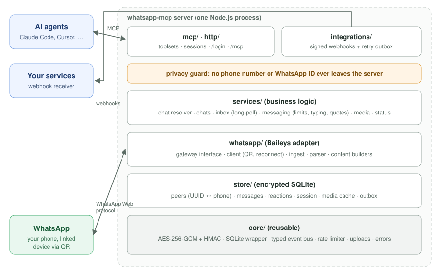

# WhatsApp MCP Server

**Give AI agents safe access to your WhatsApp:** read chats, receive new messages, reply, send photos and files, and react. Phone numbers stay on your server.

An [MCP (Model Context Protocol)](https://modelcontextprotocol.io) server for one WhatsApp account. You link it to your phone by scanning a QR code, like WhatsApp Web, and agents such as Claude Code, Cursor, VS Code or Antigravity can use your WhatsApp through tools.

<!-- <p align="center">
  
  
</p> -->

## Features

- **Phone numbers stay on the server:**
    - agents only ever see random ids (UUIDs) and names;
    - a privacy guard checks every outgoing response.
- **Read and search:** chats sorted by recent activity, unread counts, full message history, and contact search by name.
- **Receive in real time:**
    - `get_new_messages` with a cursor and long-polling;
    - live MCP notifications;
    - signed **webhooks** with retries.
- **Send like a person:**
    - **quoted replies**, with a **"typing…"** indicator for a time that matches the message length;
    - **rate limits** and a **daily cap on new chats** to protect your number from bans.
- **Media:**
    - receive photos, videos, voice notes, documents and stickers; agents get images as images they can see, and audio as audio;
    - send photos, videos, audio, voice notes and documents.
- **Reactions:** react with any emoji, remove reactions, and see who reacted to what.
- **Encrypted at rest:** the WhatsApp session, messages, contacts, phone numbers and media are all AES-256-GCM encrypted.
- **Logged in until you log out:** the session survives restarts. Login uses a one-time link, and your API key never appears in a URL.
- **Configurable:** switch groups of tools on or off (`TOOLSETS`), and tune every limit in `.env`.

## How it works



The server keeps one WhatsApp Web connection (via [Baileys](https://github.com/WhiskeySockets/Baileys)). It stores everything encrypted in SQLite, and serves tools to any number of agents over MCP (Streamable HTTP). See [docs/ARCHITECTURE.md](docs/ARCHITECTURE.md) for details.

## One account at a time

Each server is linked to **one WhatsApp account at a time**. All agents connected to it share that account.

- **To switch accounts:** log out from the current phone (WhatsApp → **Settings → Linked devices** → remove the device). The server wipes the old account's data and prints a new login link for the next account.
- **To use two accounts at once:** run a second copy of the server with its own `DATA_DIR`, `PORT`, `API_KEY` and `ENCRYPTION_KEY`. Each copy stores its data separately.

## Quick start

Requires **Node.js ≥ 22.13** and WhatsApp on your phone.

```bash
git clone https://github.com/sahilPadmani/whatsapp-mcp.git && cd whatsapp-mcp
npm install && npm run build
cp .env.example .env      # optional: secrets are generated on first start
npm start
```

1. Open the **`WhatsApp login:`** link printed in the terminal.
2. On your phone: **WhatsApp → Settings → Linked devices → Link a device** → scan the QR.
3. Connect your agent. For Claude Code, the `API_KEY` is in `.env`:

```bash
claude mcp add --transport http --scope user whatsapp http://127.0.0.1:3000/mcp \
  --header "Authorization: Bearer <API_KEY>"
```

Then ask: _"Show my unread WhatsApp chats"_ or _"Reply to Alice's last message: see you at 5"_.

**Full setup:** configuration, Cursor, VS Code, Antigravity, running as a service (systemd) and troubleshooting are all in **[docs/SETUP.md](docs/SETUP.md)**.

## Tools

| Tool               | What it does                                                                        |
| ------------------ | ----------------------------------------------------------------------------------- |
| `whatsapp_status`  | Connection state, stored counts, and the id of your own chat                        |
| `list_chats`       | Chats, most recent first, with unread count and last-message preview                |
| `search_contacts`  | Find people and groups by name                                                      |
| `get_messages`     | Messages of one chat, with media info, reactions and reply links                    |
| `get_new_messages` | New incoming messages across all chats (cursor + long-poll)                         |
| `mark_as_read`     | Send read receipts (blue ticks)                                                     |
| `send_message`     | Send text to a chat id, a name, or a phone number with country code; optional quote |
| `reply_to_message` | Quoted reply to a specific message                                                  |
| `get_media`        | Download an attachment (image / audio / file content)                               |
| `send_media`       | Send a photo, video, audio, voice note or document                                  |
| `react_to_message` | React with an emoji, or remove your reaction                                        |

There is also a resource (`whatsapp://inbox`) and a prompt (`handle_new_messages`). Full reference with examples: **[docs/TOOLS.md](docs/TOOLS.md)**.

## Documentation

| Doc                                          | Contents                                                                 |
| -------------------------------------------- | ------------------------------------------------------------------------ |
| [docs/SETUP.md](docs/SETUP.md)               | Install, configure, log in, connect clients, systemd, troubleshooting    |
| [docs/TOOLS.md](docs/TOOLS.md)               | Every tool with inputs and example outputs                               |
| [docs/ENDPOINTS.md](docs/ENDPOINTS.md)       | HTTP endpoints and login pages (with screenshots), calling MCP with curl |
| [docs/RECEIVING.md](docs/RECEIVING.md)       | Cursor polling, notifications, webhooks and signature verification       |
| [docs/ARCHITECTURE.md](docs/ARCHITECTURE.md) | Layers, data flow, encryption, where to change things                    |
| [SECURITY.md](SECURITY.md)                   | Threat model, encryption, key handling, reporting                        |
| [CONTRIBUTING.md](CONTRIBUTING.md)           | Conventions, adding tools, testing, PR checklist                         |
| [.env.example](.env.example)                 | Every setting, with defaults and explanations                            |

## Security in one paragraph

- Only clients with the `API_KEY` can use `/mcp`.
- Everything stored is encrypted with `ENCRYPTION_KEY` (**back it up**).
- The server binds to `127.0.0.1` by default; to expose it, put a TLS reverse proxy in front.
- Phone numbers and WhatsApp IDs never leave the server.
- Incoming messages are written by other people: agents should treat them as information, not instructions.

Details: [SECURITY.md](SECURITY.md).

## Development

```bash
npm run dev          # watch mode
npm test             # 127 tests, no WhatsApp account needed
npm run check        # lint + typecheck + format + tests with coverage thresholds
```

New contributors: read [docs/ARCHITECTURE.md](docs/ARCHITECTURE.md), then [CONTRIBUTING.md](CONTRIBUTING.md).

## Disclaimer

This is an independent open-source project. It is **not affiliated with, endorsed by, or sponsored by WhatsApp LLC or Meta Platforms, Inc.** "WhatsApp" is a trademark of its owner and is used here only to describe what the software works with.

The software connects to WhatsApp through [Baileys](https://github.com/WhiskeySockets/Baileys), an unofficial, reverse-engineered client. Using unofficial clients or automating a WhatsApp account may violate the [WhatsApp Terms of Service](https://www.whatsapp.com/legal/terms-of-service). WhatsApp may restrict, suspend or permanently ban accounts that do so, in particular accounts that send unsolicited, bulk or automated messages.

By using this software, you acknowledge and agree that:

- you use it **at your own risk**, and you are solely responsible for how you and any AI agent or automation you connect use it. This includes compliance with WhatsApp's terms and with applicable laws, such as privacy, data-protection, anti-spam and telecommunications rules;
- the author and contributors are **not responsible or liable** for any account restriction or ban, loss of data or messages, messages sent by connected agents, or any other direct or indirect damage arising from its use;
- the software is provided **"as is", without warranty of any kind**, as stated in the [MIT License](LICENSE).

Use it only with an account you own, and only to contact people who expect to hear from you.

## License

Copyright © 2026 Sahil Padmani. Released under the [MIT License](LICENSE).

## Acknowledgements

- [Baileys](https://github.com/WhiskeySockets/Baileys) by WhiskeySockets: the WhatsApp Web protocol implementation this project builds on.
- [Model Context Protocol](https://modelcontextprotocol.io) and its TypeScript SDK.
