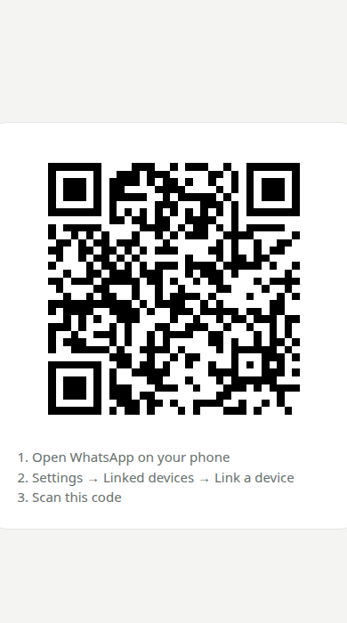
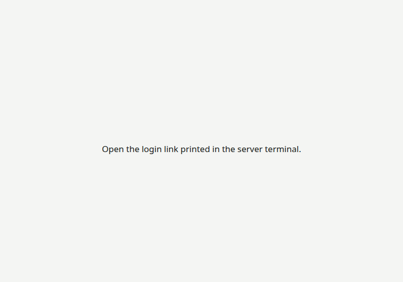
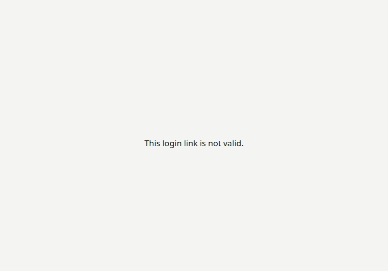

# HTTP endpoints

The server listens on `HOST:PORT` (default `127.0.0.1:3000`). One server serves **one WhatsApp account at a time**. There is no web dashboard: the web pages only handle login, and everything else goes through MCP.

| Method   | Path                    | Auth                              | Purpose                                                                                                                                                          |
| -------- | ----------------------- | --------------------------------- | ---------------------------------------------------------------------------------------------------------------------------------------------------------------- |
| `POST`   | `/mcp`                  | `Authorization: Bearer <API_KEY>` | MCP JSON-RPC requests (Streamable HTTP). The first request must be `initialize`; the response carries an `mcp-session-id` header to send on every later request. |
| `GET`    | `/mcp`                  | Bearer + `mcp-session-id`         | Server→client SSE stream for notifications (new messages, reactions, inbox updates).                                                                             |
| `DELETE` | `/mcp`                  | Bearer + `mcp-session-id`         | Ends the session. Idle sessions also close after `MCP_SESSION_IDLE_MS`.                                                                                          |
| `GET`    | `/login/<token>`        | the one-time token                | QR login page (only while a QR is needed).                                                                                                                       |
| `GET`    | `/login/<token>/events` | the one-time token                | Live QR updates for the login page (SSE). Ends once logged in.                                                                                                   |
| `GET`    | `/healthz`              | none                              | Liveness: `200 {"status":"ok"}` while the process runs.                                                                                                          |
| `GET`    | `/readyz`               | none                              | Readiness: `200 {"whatsapp":"open"}` when connected, otherwise `503` with the current state.                                                                     |
| `GET`    | any other path          | none                              | A page with one sentence (see below).                                                                                                                            |

## Login pages

The login link is printed in the terminal **only when a QR is needed**: on first start, or after you log out from your phone.


**1. Login page (`/login/<token>`).** It shows the QR and three steps, and the QR refreshes automatically.

| Desktop                               | Phone-sized window                                   |
| ------------------------------------- | ---------------------------------------------------- |
|  |  |

**2. After scanning.** The page switches to one sentence, and the link stops working.


**3. Every other page:**

| Before login (no link opened)            | Wrong or expired link                    |
| ---------------------------------------- | ---------------------------------------- |
|  |  |

The pages never show your number, your chats, the API key, or a logout button. To log out, open WhatsApp on your phone → **Settings → Linked devices**, and remove the device. The server then wipes its stored data and prints a new login link.

> The QR in these screenshots is a placeholder from a demo instance, not a real login code.

## Security notes

- The login token is 192 random bits, unrelated to `API_KEY`, and valid only until login succeeds.
- Login pages are sent with `Cache-Control: no-store` and `Referrer-Policy: no-referrer`. All pages send CSP, `X-Frame-Options: DENY` and `nosniff`.
- When bound to localhost, requests with a foreign `Host` header are rejected (DNS-rebinding protection). Behind a proxy, set `PUBLIC_URL`, and only that host is accepted.

## Calling `/mcp` by hand (curl)

```bash
KEY=$(grep ^API_KEY= .env | cut -d= -f2)

# 1. initialize → read the session id from the response headers
curl -si http://127.0.0.1:3000/mcp \
  -H "Authorization: Bearer $KEY" -H "Content-Type: application/json" -H "Accept: application/json, text/event-stream" \
  -d '{"jsonrpc":"2.0","id":1,"method":"initialize","params":{"protocolVersion":"2025-06-18","capabilities":{},"clientInfo":{"name":"curl","version":"1"}}}' \
  | grep -i mcp-session-id

# 2. call a tool with that session id
curl -s http://127.0.0.1:3000/mcp \
  -H "Authorization: Bearer $KEY" -H "mcp-session-id: <id from step 1>" \
  -H "Content-Type: application/json" -H "Accept: application/json, text/event-stream" \
  -d '{"jsonrpc":"2.0","id":2,"method":"tools/call","params":{"name":"whatsapp_status","arguments":{}}}'
```

In practice, use an MCP client instead (see [SETUP.md](SETUP.md#connect-an-ai-agent)).
