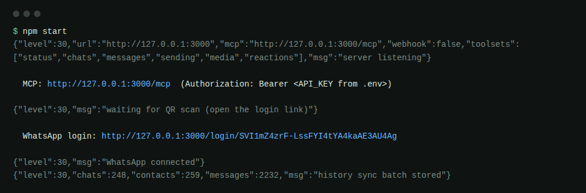
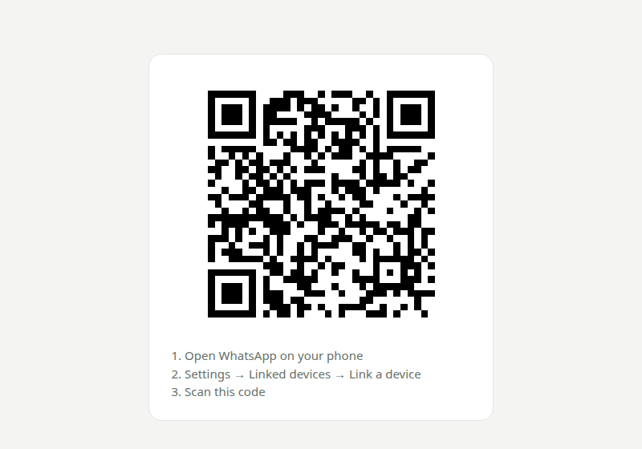
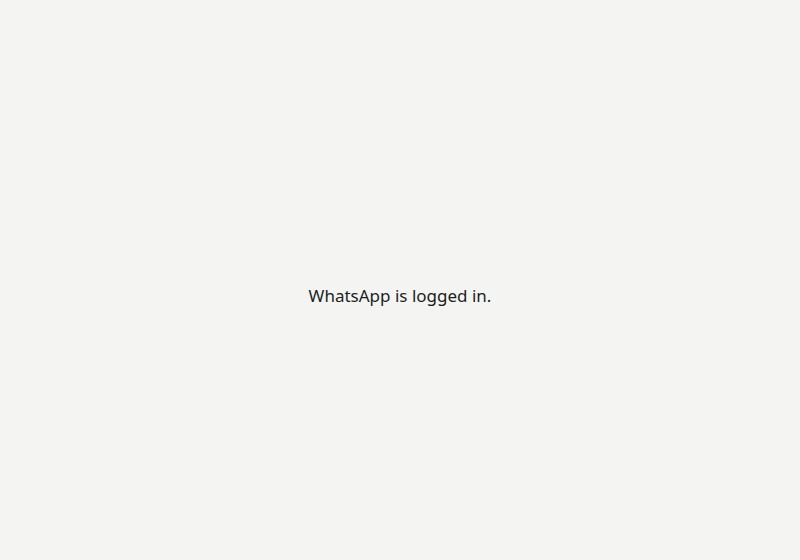

# Setup guide

This guide takes you from nothing to an AI agent reading and sending WhatsApp messages, in about 10 minutes.

## 1. Requirements

- **Node.js 22.13 or newer.** Check with `node -v`. The server uses Node's built-in SQLite, so no native build tools are needed.
- **A WhatsApp account on your phone.** The server becomes one of its "linked devices", like WhatsApp Web.

> ⚠️ This project uses [Baileys](https://github.com/WhiskeySockets/Baileys), an unofficial WhatsApp Web client. Automating a personal account breaks WhatsApp's Terms of Service, and accounts that send spam or many automated messages get banned. Use a number you can afford to lose, and keep the default limits. Read the [disclaimer](../README.md#disclaimer) before you use it.

## 2. Install

```bash
git clone https://github.com/sahilPadmani/whatsapp-mcp.git
cd whatsapp-mcp
npm install
npm run build
```

## 3. Configure

```bash
cp .env.example .env
```

You can start without editing anything. On the first start, the server:

- generates `API_KEY` (the password MCP clients use) and `ENCRYPTION_KEY` (which encrypts all stored data);
- writes both into `.env`, with file permissions 600.

> **Back up `ENCRYPTION_KEY`.** Without it, the stored session and messages can't be decrypted, and you would have to log in again.

Settings you may want to change (all of them are listed and explained in [`.env.example`](../.env.example)):

| Setting                          | Default              | Change it if…                                                              |
| -------------------------------- | -------------------- | -------------------------------------------------------------------------- |
| `PORT` / `HOST`                  | `3000` / `127.0.0.1` | the port is taken, or you run behind a reverse proxy                       |
| `SEND_MAX_PER_HOUR`              | `30`                 | you need more or fewer messages per hour                                   |
| `NEW_CHAT_MAX_PER_DAY`           | `10`                 | you message new people more often (this raises the ban risk)               |
| `ALLOW_SEND_TO_PHONE`            | `true`               | you don't want agents to send to raw phone numbers                         |
| `MEDIA_SEND_DIR`                 | empty                | you want agents to send files from a folder (otherwise base64 only)        |
| `WEBHOOK_URL` / `WEBHOOK_SECRET` | empty                | another service should receive every new message                           |
| `TOOLSETS`                       | `all`                | you want to expose fewer tools, e.g. `chats,messages` for read-only access |

## 4. Start and log in

```bash
npm start
```



1. Open the **`WhatsApp login:`** link from the terminal. It's a one-time link, and it doesn't contain your API key.
2. On your phone, open WhatsApp → **Settings → Linked devices → Link a device**.
3. Scan the QR code.



The page switches to **"WhatsApp is logged in."** and the link stops working. Your chat history then syncs into the encrypted database, which can take a minute.



**You stay logged in across restarts.** The session is saved encrypted in `data/`. Run `npm start` again and it reconnects without a QR.

## 5. Connect an AI agent

You need two things:

- **MCP URL:** `http://127.0.0.1:3000/mcp`
- **API key:** the `API_KEY=` value in `.env`

### Claude Code

```bash
claude mcp add --transport http --scope user whatsapp http://127.0.0.1:3000/mcp \
  --header "Authorization: Bearer <API_KEY>"
```

Or add a `.mcp.json` to a project. This version keeps the key in an environment variable instead of the file:

```json
{
    "mcpServers": {
        "whatsapp": {
            "type": "http",
            "url": "http://127.0.0.1:3000/mcp",
            "headers": { "Authorization": "Bearer ${WHATSAPP_MCP_KEY}" }
        }
    }
}
```

To check the connection, run `/mcp` in Claude Code. `whatsapp` should show as connected.

### Cursor (`~/.cursor/mcp.json`) / Claude Desktop

```json
{
    "mcpServers": {
        "whatsapp": {
            "url": "http://127.0.0.1:3000/mcp",
            "headers": { "Authorization": "Bearer <API_KEY>" }
        }
    }
}
```

### VS Code (`~/.config/Code/User/mcp.json`)

```json
{
    "servers": {
        "whatsapp": {
            "type": "http",
            "url": "http://127.0.0.1:3000/mcp",
            "headers": { "Authorization": "Bearer <API_KEY>" }
        }
    }
}
```

### Antigravity, or any client that only supports command-style (stdio) servers

```json
{
    "mcpServers": {
        "whatsapp": {
            "command": "npx",
            "args": ["-y", "mcp-remote", "http://127.0.0.1:3000/mcp", "--header", "Authorization:${AUTH_HEADER}"],
            "env": { "AUTH_HEADER": "Bearer <API_KEY>" }
        }
    }
}
```

### Test without a client

Run `npx @modelcontextprotocol/inspector`, choose **Streamable HTTP**, enter the URL, and add the header `Authorization: Bearer <API_KEY>`.

## 6. Try it

Ask your agent, for example:

- "Show my unread WhatsApp chats."
- "Read my last messages with Alice and summarise them."
- "Reply to Alice's last message: I'll be there at 5."
- "Send the photo in my send folder to the Team group."

**Safe first test:** `whatsapp_status` returns `me.id`, which is your own "Message yourself" chat. Send test messages there. Notes you type into that chat on your phone also reach the agent as new messages, so it doubles as a command channel.

## 7. Keep it running (Linux, systemd)

```ini
# ~/.config/systemd/user/whatsapp-mcp.service
[Unit]
Description=WhatsApp MCP server

[Service]
WorkingDirectory=%h/whatsapp-mcp
ExecStart=/usr/bin/env npm start
Restart=on-failure

[Install]
WantedBy=default.target
```

```bash
systemctl --user enable --now whatsapp-mcp
journalctl --user -u whatsapp-mcp -f   # the login link appears here when needed
```

## 8. Log out

Open WhatsApp on your phone → **Settings → Linked devices**, and remove the device. The server then:

- deletes the session and all stored data;
- prints a new login link.

## 9. One account at a time

A server is linked to **one WhatsApp account at a time**.

- **To switch to another account:** log out (step 8). The old account's data is wiped, and the new login link is for the next account.
- **To use several accounts at the same time:** run one server per account, each with its own folder and settings:

```bash
# second account, in another copy of the project (or another .env file)
DATA_DIR=./data-work PORT=3001 API_KEY=<another key> ENCRYPTION_KEY=<another key> npm start
```

Then connect your agent to each one under a different name, for example `whatsapp` → `http://127.0.0.1:3000/mcp` and `whatsapp-work` → `http://127.0.0.1:3001/mcp`.

## Troubleshooting

| Problem                                  | Fix                                                                                                                                  |
| ---------------------------------------- | ------------------------------------------------------------------------------------------------------------------------------------ |
| `401 Unauthorized`                       | Wrong key or missing `Bearer ` prefix. Copy `API_KEY` from `.env` again.                                                             |
| Connection refused                       | The server isn't running (`npm start`), or `PORT` is different.                                                                      |
| Tools say "WhatsApp is not logged in"    | Open the login link printed in the terminal and scan the QR.                                                                         |
| `403` with a "Host" error                | Use `127.0.0.1` or `localhost` in the URL, or set `PUBLIC_URL` when using a proxy.                                                   |
| `ENCRYPTION_KEY does not match`          | `.env` has a different key from the one the database was created with. Restore the original key, or delete `data/` and log in again. |
| "This phone number is not on WhatsApp."  | The number has no WhatsApp account, or it is missing the country code.                                                               |
| "Sending too fast" / "Hourly send limit" | These are the safety limits; wait, or raise them in `.env` carefully.                                                                |
| The QR keeps refreshing                  | That's normal: WhatsApp rotates it about every 20 seconds. Scan the current one.                                                     |
